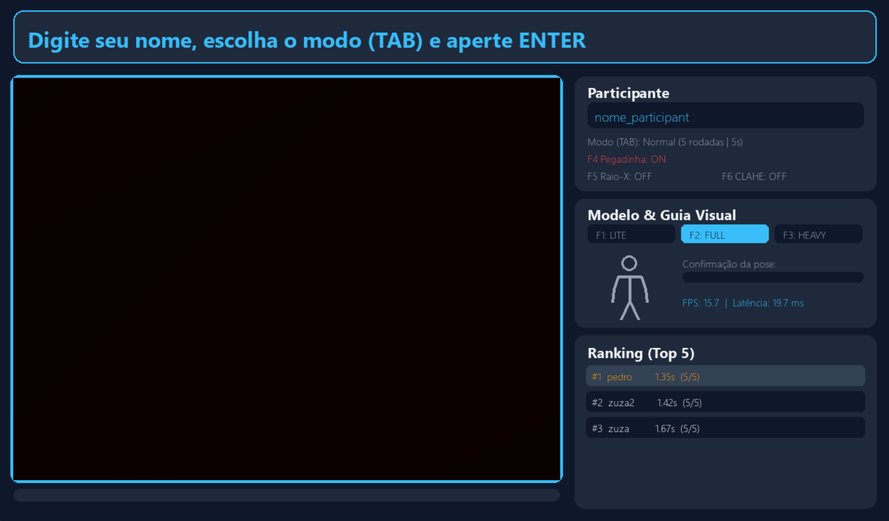

# ⚡ Desafio de Reação Corporal — PDI & Visão Computacional


Um jogo interativo em tempo real desenvolvido como projeto prático de **Processamento Digital de Imagens (PDI)** e **Visão Computacional**. O sistema desafia os reflexos do jogador solicitando a reprodução de poses corporais capturadas por webcam, avaliando precisão geométrica, tempo de reação e estabilidade espacial.

---

## 🎯 Sumário

- [Visão Geral](#-visão-geral)
- [Funcionalidades Principais](#-funcionalidades-principais)
- [Fundamentação Técnica e PDI](#-fundamentação-técnica-e-pdi)
- [Estrutura do Projeto](#-estrutura-do-projeto)
- [Requisitos e Dependências](#-requisitos-e-dependências)
- [Como Executar](#-como-executar)
- [Atalhos de Teclado (Hotkeys)](#-atalhos-de-teclado-hotkeys)
- [Métricas e Avaliação Técnica](#-métricas-e-avaliação-técnica)
- [Licença](#-licença)

---

## 📸 Visão Geral

O jogo sorteia comandos visuais que exigem posturas específicas do usuário (ex.: *Levantar Braço Direito*, *Posição em T*, *Mãos Cruzadas*, *Super-Herói*, etc.). O sistema mede o tempo que o jogador leva para assumir a pose corretamente a partir da posição neutra.



---

## ✨ Funcionalidades Principais

- **10 Poses Reconhecidas:** Conjunto otimizado de movimentos para máxima distinção geométrica e alta taxa de acerto.
- **Modo Pegadinha (`F4`):** Comandos em vermelho exigem que o jogador permaneça imóvel, testando o autocontrole.
- **Modo Raio-X / Telemetria ao Vivo (`F5`):** Exibição em tempo real dos ângulos articulares, inclinação de tronco e índice de visibilidade dos *landmarks*.
- **Pré-processamento CLAHE (`F6`):** Equalização adaptativa de histograma no canal $L$ do espaço de cor $LAB$ para ambientes com pouca luz ou contraluz.
- **Troca Dinâmica de Modelos (`F1`-`F3`):** Alternância em tempo de execução entre os modelos `LITE`, `FULL` e `HEAVY` do MediaPipe Pose Landmarker.
- **Filtro de Estabilidade Temporal:** Validação por acúmulo de frames consecutivos para evitar falsos positivos causados por ruídos de rastreamento.
- **Pódio Foto-Sprint:** Captura automática com overlay customizado da foto do participante ao entrar no Top Ranking.
- **Relatório Estatístico (`avaliacao.py`):** Geração automática de gráficos de **FPS**, **Latência** e **Taxa de Acerto por Pose** via Matplotlib.

---

## 🔬 Fundamentação Técnica e PDI

O pipeline da aplicação utiliza técnicas clássicas e modernas de computação gráfica e PDI:

1. **Equalização Adaptativa de Histograma (CLAHE):**
   Para contornar variações de iluminação, a imagem $RGB$ é convertida para o espaço de cor $LAB$. O algoritmo CLAHE (*Contrast Limited Adaptive Histogram Equalization*) é aplicado exclusivamente no canal de luminância ($L$), preservando a cromaticidade das cores originais e destacando o contorno corporal.
   $$\text{HSV / LAB} \rightarrow \text{Equalização do Canal } L \rightarrow \text{Reconversão para } BGR$$

2. **Cálculo de Ângulos Vetoriais Triangulares:**
   A detecção de poses baseia-se na trigonometria entre três pontos-chave (ex.: Ombro $A$, Cotovelo $B$, Pulso $C$):
   $$\theta = \arccos\left( \frac{\vec{BA} \cdot \vec{BC}}{\|\vec{BA}\| \|\vec{BC}\|} \right)$$
   Esse cálculo vetorial garante imunidade a variações de escala e distância do jogador em relação à câmera.

3. **Filtragem Temporal de Confirmação:**
   Um estado só é validado quando a condição geométrica se mantém verdadeira por $N$ frames consecutivos (padrão: 4 frames), eliminando artefatos de amostragem.

---

## 📁 Estrutura do Projeto

```text
.
├── main.py                    # Loop principal da aplicação, UI em Pygame e máquina de estados
├── detector.py                # Pipeline OpenCV + MediaPipe Pose Task, CLAHE e Modo Raio-X
├── movimentos.py              # Regras geométricas das 10 poses e filtro de estabilidade
├── ranking.py                 # Gerenciamento do arquivo JSON de pontuações
├── sons.py                    # Síntese e reprodução de efeitos sonoros
├── avaliacao.py               # Dashboard estatístico em Matplotlib (FPS, Latência, Poses)
├── pose_landmarker_lite.task  # Modelo leve do MediaPipe (alta velocidade)
├── pose_landmarker_full.task  # Modelo intermediário (balanceado)
├── pose_landmarker_heavy.task # Modelo de alta precisão
├── metricas_execucao.json     # Telemetria salva para análise posterior
├── ranking.json               # Histórico das melhores pontuações
└── fotos_podio/               # Fotos capturadas nas partidas vitoriosas
```

---

## 🛠️ Requisitos e Dependências

- **Python 3.9** ou superior
- **Webcam** operacional

### Bibliotecas necessárias:

```bash
pip install opencv-python mediapipe pygame numpy matplotlib
```

*(Certifique-se de que os arquivos de modelo `.task` do MediaPipe estejam salvos na raiz do projeto).*

---

## 🚀 Como Executar

1. **Clone o repositório:**
   ```bash
   git clone https://github.com/seu-usuario/desafio-reacao-corporal.git
   cd desafio-reacao-corporal
   ```

2. **Execute o jogo:**
   ```bash
   python main.py
   ```

3. **Gere o relatório estatístico técnico:**
   Ao finalizar suas partidas, feche o jogo e execute:
   ```bash
   python avaliacao.py
   ```
   O gráfico `relatorio_avaliacao.png` será gerado automaticamente.

---

## ⌨️ Atalhos de Teclado (Hotkeys)

| Tecla | Ação | Descrição |
| :---: | :--- | :--- |
| `F1` | Modelo **LITE** | Prioriza taxa de quadros (FPS máximo) |
| `F2` | Modelo **FULL** | Equilíbrio ideal entre FPS e precisão *(Padrão)* |
| `F3` | Modelo **HEAVY** | Máxima precisão de rastreamento 3D |
| `F4` | Toggle **Pegadinha** | Ativa/Desativa desafios de autocontrole |
| `F5` | Toggle **Modo Raio-X** | Exibe ângulos das articulações e HUD de telemetria |
| `F6` | Toggle **CLAHE** | Liga/Desliga pré-processamento para ambientes escuros |
| `TAB` | Alternar Modo | Alterna entre modo Normal (5 rodadas) e Turbo (8 rodadas) |
| `ENTER` | Confirmar / Iniciar | Confirma nome e avança telas |
| `ESC` | Sair | Encara a aplicação a qualquer momento |

---

## 📊 Métricas e Avaliação Técnica

O sistema monitora continuadamente o desempenho do pipeline de Visão Computacional. Através do script `avaliacao.py`, é possível analisar:

- **Estabilidade de Quadro (FPS):** Comparativo direto de velocidade entre os três modelos MediaPipe.
- **Latência de Inferência (ms):** Tempo gasto estritamente no processamento do modelo por frame.
- **Taxa de Acerto por Pose:** Identificação de disparidades no reconhecimento das posturas.

---

## 👥 Créditos

**Alunos:**

| Nome completo | Matrícula |
|---|---|
| José Nunes de Sousa Neto | 20250071231 |
| Manoel Lucas Pacheco Júnior | 20250071269 |
| Maria Laura Rangel Urbano Cronemberger | 20250071287 |


**Disciplina:** EECP0024 - Processamento de Imagens

**Professor:** Prof. Dr. Haroldo Gomes Barroso Filho

**Instituição:** UFMA — Universidade Federal do Maranhão

**Semestre:** 2026.2

---

## 📄 Licença

Este projeto está licenciado sob a Licença MIT — consulte o arquivo [LICENSE](LICENSE) para obter mais detalhes.

---
*Desenvolvido como projeto prático para a disciplina de Processamento Digital de Imagens (PDI).*

---

<div align="center">

**Este repositório possui fins acadêmicos.**

</div>

---
